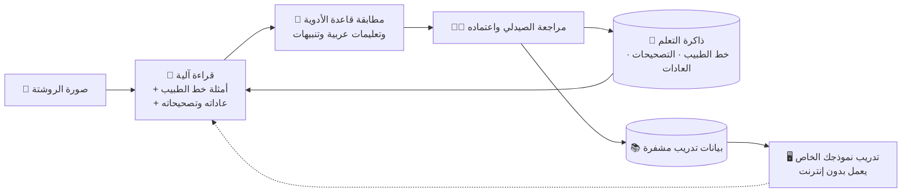

<div dir="rtl">

# رُشد — قارئ الروشتات الذكي

**يقرأ الروشتات المكتوبة بخط اليد، ويتعلم خط كل طبيب من مراجعات صيادلتك، ويحمي بيانات المرضى بتشفير على كل المستويات.**

رُشد تطبيق ويب عربي (يعمل على الموبايل والكمبيوتر) لمجموعات الصيدليات في مصر:
يصوّر الصيدلي الروشتة، فيقرأها الذكاء الاصطناعي ويطابق الأدوية مع قاعدة الأدوية المصرية،
ويكتب طريقة الاستخدام بالعربي، وينبّه للتكرار والتداخلات. ثم يراجع الصيدلي ويعتمد —
**وكل اعتماد يجعل القراءة القادمة أدق.**

> ⚠️ رُشد أداة مساعدة للصيدلي وليست بديلاً عنه: الصرف يتم دائماً بعد مراجعة صيدلي مرخّص.

---

## ما الذي يميّز رُشد؟

| | |
|---|---|
| 📸 **من الكاميرا مباشرة** | تطبيق ويب يعمل على أي موبايل (ويُثبَّت كتطبيق PWA)؛ صوّر واقرأ في ثوانٍ. |
| 🧠 **يتعلم خط كل طبيب** | الروشتات المعتمدة لنفس الطبيب تُعرض على القارئ الآلي كأمثلة لخطه، فيقرأ الخط الصعب بشكل أدق في كل مرة. |
| 🔁 **يتذكر تصحيحاتك** | لو قرأ «Augmantin» وصححتها إلى «Augmentin» لهذا الطبيب، لن يكرر الخطأ. |
| 💊 **يعرف عادات الأطباء** | يعرف أن هذا الطبيب يكتب «Motinorm» لا «Motilium»، ويستخدم ذلك لحسم الخطوط الملتبسة. |
| 🎯 **ألوان الثقة** | كل دواء أخضر/أصفر/أحمر حسب ثقة القراءة، مع بدائل مقترحة بنقرة واحدة. |
| 🏷️ **ملصقات عربية جاهزة للطباعة** | «قرص واحد ٣ مرات يومياً (كل ٨ ساعات) بعد الأكل لمدة ٥ أيام» — من «1×3 p.c 5/7». |
| ⚠️ **تنبيهات أمان** | تكرار المادة الفعالة (مثل Panadol + Congestal = باراسيتامول مرتين)، تكرار المجموعة الدوائية، وأهم التداخلات المعروفة. |
| 🎓 **أكاديمية لتدريب الصيادلة** | الصيادلة الجدد يتدربون على قراءة روشتات حقيقية مراجَعة، بدرجات ولوحة شرف — مصممة لمدير التدريب. |
| 📈 **مركز تدريب يقيس التعلّم** | منحنى أسبوعي لدقة القراءة، والأطباء الذين تعلّم خطهم، والتكلفة. |
| 🖥️ **نموذجك الخاص بدون إنترنت** | درّب نموذجاً مفتوح المصدر على روشتاتك؛ يُحفظ مشفراً ويعمل على خادمك فقط. |
| 🔒 **حماية متعددة الطبقات** | تشفير AES‑256، تحقق بخطوتين، سجل أمان غير قابل للتلاعب، وأكثر — انظر [دليل الأمان](docs/SECURITY.md). |

## كيف يتعلم؟



1. **من اليوم الأول**: القراءة بنموذج Claude للرؤية (من Anthropic) — دقيق جداً مع الخطوط الصعبة.
2. **مع كل مراجعة**: تُحفظ الروشتة المعتمدة كمثال لخط طبيبها، وتُسجَّل التصحيحات وعادات الوصف.
3. **عند تراكم البيانات** (مئات الروشتات): تدرّب نموذجك المحلي، تقيس دقته في «الوضع الخفي»، ثم تنتقل تدريجياً لوضع «محلي أولاً» أو «محلي بالكامل».

التفاصيل في [دليل التدريب والتغذية](docs/TRAINING.md).

---

## التشغيل

### ١) نسخة ويندوز جاهزة — بدون تثبيت أي شيء

- حمّل الملف `Rushd-Windows-1.0.0.zip` وفك ضغطه في مكان ثابت (مثلاً المستندات).
- اضغط مرتين على **`Start-Rushd`**: يفتح رُشد في نافذة خاصة به، وفي أول مرة يفتح ملف فيه كلمة مرور المدير المؤقتة.
- **للموبايلات داخل الصيدلية**: شغّل **`Share-with-phones`** بدلاً منه، وامسح رمز QR الذي يظهر بكاميرا الموبايل (نفس الواي فاي).
- البيانات مشفرة في `%LOCALAPPDATA%\Rushd` خارج مجلد البرنامج، فالتحديث لنسخة أحدث لا يمس بياناتك. التفاصيل في `README-AR.txt` داخل الملف.
- ويندوز 10 أو 11 (64 بت). لبناء الملف من الكود: `python desktop/build_windows.py`.

### ١-ب) تطبيق أندرويد

- ثبّت الملف `Rushd-Android-1.0.0.apk` على الموبايل (اسمح بالتثبيت من مصادر غير معروفة عند السؤال).
- شغّل رُشد على كمبيوتر الصيدلية بملف **`Share-with-phones`**، واجعل الموبايل على نفس الواي فاي.
- افتح التطبيق واضغط **«ابحث عن رُشد على الواي فاي»** — يجد الكمبيوتر وحده، أو اكتب العنوان الظاهر عليه أو عنوان خادمك (https).
- يضيف التطبيق: كاميرا الموبايل لتصوير الروشتة، طباعة الملصقات عبر طابعات أندرويد، ومنع لقطات الشاشة لحماية بيانات المرضى.
- أندرويد 7.0 أو أحدث. لبنائه من الكود: `python android/build_apk.py` (يحتاج حزم أدوات أندرويد من Ubuntu، انظر أول الملف).

### ١-ج) تجربة من الكود مباشرة (للمطورين)

يحتاج Python 3.11 أو أحدث.

- **ويندوز**: افتح PowerShell داخل مجلد المشروع وشغّل:
  ```powershell
  powershell -ExecutionPolicy Bypass -File scripts\run-local.ps1
  ```
- **لينكس / ماك**:
  ```bash
  ./scripts/run-local.sh
  ```

ثم افتح `http://localhost:8000`. في أول تشغيل يطبع البرنامج **كلمة مرور مؤقتة لحساب `admin`** — سجّل بها الدخول وسيُطلب منك تغييرها ثم تفعيل التحقق بخطوتين.

لتفعيل القراءة بالذكاء الاصطناعي ضع مفتاح Claude API قبل التشغيل:
```bash
export ANTHROPIC_API_KEY=sk-ant-...        # لينكس/ماك
$env:ANTHROPIC_API_KEY = "sk-ant-..."      # ويندوز
```

### ٢) التشغيل الفعلي لمجموعة الصيدليات (Docker + HTTPS)

على خادم (سحابي أو داخل المقر) عليه Docker:

```bash
cp .env.example .env          # ضع اسم النطاق RUSHD_DOMAIN ومفتاح ANTHROPIC_API_KEY
docker compose up -d --build
docker compose logs rushd     # كلمة مرور المدير المؤقتة (أول تشغيل فقط)
```

- **Caddy** يستخرج شهادة HTTPS مجانية ويجددها تلقائياً.
- التطبيق نفسه غير مكشوف للشبكة؛ يعمل بمستخدم بلا صلاحيات، على نظام ملفات للقراءة فقط.
- البيانات في وحدة تخزين `rushd-data`، **والمفتاح الرئيسي في وحدة منفصلة `rushd-secrets`**.
- لشبكة داخلية بدون نطاق: ضع اسم/عنوان الخادم في `RUSHD_DOMAIN` وأضف `tls internal` في `deploy/Caddyfile`.

### ٣) أول إعداد بعد الدخول كمدير

1. **الإعدادات**: اسم الصيدلية (للملصقات)، النموذج، حد الميزانية الشهرية.
2. **المستخدمون**: أضف الفروع والصيادلة (كل مستخدم يأخذ كلمة مرور مؤقتة).
3. **قاعدة الأدوية**: استورد القائمة الرسمية الكاملة (CSV) لتغطية كل الأصناف — القائمة المرفقة ~٢٠٠ صنف شائع للبداية فقط.
4. **تغذية النظام**: ارفع دفعة روشتات قديمة وراجعها، أو استورد أرشيفاً مُفرغاً مسبقاً.

---

## التكلفة (تقديرية)

القراءة السحابية تُحاسب بالـ tokens حسب أسعار Anthropic:

| النموذج | تقدير تقريبي للروشتة الواحدة |
|---|---|
| `claude-opus-5-5` (الافتراضي — الأدق) | حوالي ٠٫٠٥–٠٫١٠ دولار |
| `claude-sonnet-5-5` | حوالي نصف التكلفة |

التكلفة الفعلية لكل روشتة تظهر في **مركز التدريب**، ويمكنك وضع **حد شهري** يوقف القراءة السحابية عند بلوغه.
القراءة الثانية بأمثلة خط الطبيب لا تحدث إلا عند الشك. وبعد تدريب نموذجك المحلي يمكن أن تنخفض التكلفة لصفر تقريباً.

## الخصوصية والقانون

- الصور والقراءات **مشفرة على الخادم**، وأسماء المرضى يمكن إخفاؤها من الصورة **على الموبايل قبل الرفع**.
- في الوضع السحابي تُرسل صورة الروشتة لخدمة Anthropic للقراءة. راجع شروط الخدمة وسياسة الاحتفاظ بالبيانات لديهم.
- **قانون حماية البيانات الشخصية المصري رقم ١٥١ لسنة ٢٠٢٠** يعامل البيانات الصحية كبيانات حساسة، وقد يتطلب نقلها خارج مصر تصريحاً. استشر مستشاراً قانونياً، وإن لزم استخدم وضع «محلي بالكامل» بعد تدريب نموذجك.

## النسخ الاحتياطي والمفتاح الرئيسي (مهم جداً)

- **المفتاح الرئيسي** (`secrets/master.key`) هو الشيء الوحيد الذي يفك تشفير كل البيانات. **احتفظ بنسخة منه خارج الخادم** (مثلاً فلاشة في خزنة). بدونه لا يمكن استرجاع أي شيء — ولا حتى منّا.
- نسخة احتياطية مشفرة:
  ```bash
  docker compose exec rushd python -m rushd backup /data/backup-$(date +%F).rushd
  ```
- أوامر أخرى: `restore`، `rotate-key` (تدوير المفتاح)، `verify-audit`، `reset-password` — انظر [دليل الأمان](docs/SECURITY.md).

---

## الأدلة

- 📘 [دليل الاستخدام للصيادلة](docs/USER_GUIDE.md)
- 🧠 [دليل التغذية والتدريب](docs/TRAINING.md)
- 🔒 [دليل الأمان والحماية](docs/SECURITY.md)

</div>

---

## For developers

**Stack**: Python 3.11+ / FastAPI / SQLAlchemy (SQLite, WAL) · vanilla-JS ES modules (no build step, no CDN, strict CSP) · Claude vision via the official `anthropic` SDK (structured outputs, prompt caching, server-side refusal fallback) · optional PyTorch + Transformers + PEFT (LoRA on an open VLM, default `Qwen/Qwen2-VL-2B-Instruct`).

```
backend/rushd/
  ai/          engines (Claude + local), prompts, schema, lexicon (fuzzy drug matching),
               sig (dose parsing -> Arabic label), safety checks, learning memory, metrics
  api/         REST endpoints (auth, prescriptions, batches, drugs, doctors, training, academy, users, admin)
  security/    AES-256-GCM keyring, Argon2id, sessions + CSRF, TOTP, rate limiting, audit chain, headers
  services/    reading pipeline + worker, verification (learning), intake, import, stats, accounts
  training/    LoRA fine-tuning, encrypted adapter bundles, local inference, encrypted exports
  cli.py       init · serve · backup/restore · rotate-key · verify-audit · import-drugs · read
               import-dataset · train · export-model/import-model (headless GPU training)
frontend/      Arabic RTL PWA (index.html, css/, js/lib, js/components, js/views)
desktop/       Windows package: bundled CPython (NuGet, SHA-512 checked) + launcher; build_windows.py
android/       Android app: WebView shell (camera, printing, Wi-Fi discovery, FLAG_SECURE); build_apk.py
```

```bash
cd backend
pip install -r requirements-dev.txt
pytest                      # ~100 tests; tests/test_local_training.py runs if torch is installed
ruff check rushd tests
python -m tests.e2e_server  # the real app + scripted fake AI, for browser testing
```

The full training loop (train -> encrypt adapter -> activate -> read offline) is tested end-to-end
with a tiny randomly initialised Qwen2-VL checkpoint built on the fly (`tests/tiny_vlm.py`).

© 2026 — All rights reserved. Fonts: IBM Plex Sans Arabic (SIL OFL 1.1, see `frontend/fonts/OFL.txt`).
